<p align="center">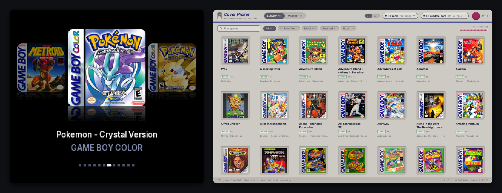</p>

# Cover Flow for the Analogue Pocket

A box-art game menu that lives inside the Game Boy Color core on the Analogue Pocket, and a Mac app that fills it. Turn the core on and you land on your library as full-color covers at 320x288: the selected game in the middle, its neighbors either side, reflections on the floor and the title underneath. Libraries of hundreds of games stream from the card as you scroll; it opens on your favorites, Select switches to every game A to Z where Up and Down jump by letter, and X opens a game's options. Press A and the game boots with its battery save loaded. Press L in game to pause, then Resume, or go Home to the covers with the game suspended. Pick it again later and it comes back on the exact frame you left. Push a cartridge into the slot and its cover drops into the menu from the top, shoving your list out of the way, and seats with a ring of light, a shine across the box and a glow in its colors; A plays the real cart. A cart that isn't in your library shows as a cartridge with its own title, and the next sync finds its box art. On the Mac, the companion app names every ROM in your library by checksum, finds its box art, and syncs it all to the SD card.

<p align="center"><b>Get it: <a href="https://github.com/maxsorto/openfpga-GBC/tree/cover-picker">the cover-picker branch</a></b><br>Analogue Pocket, openFPGA. Game Boy and Game Boy Color games.<br><b>Fill it: <a href="companion/">the companion app</a></b> (in <code>companion/</code>), runs on your Mac in the browser.</p>

This is a fork of budude2's openFPGA GBC core, which is a port of the MiSTer Gameboy core. The emulation is theirs. The menu, saves, suspend, cartridge detection and the companion app are new. No ROMs, BIOS files or box art are in this repo.

<table>
  <tr>
    <td width="50%">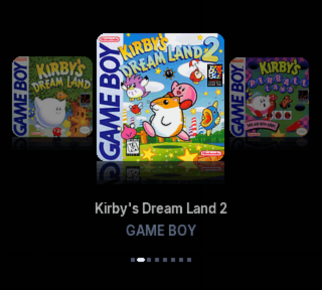</td>
    <td width="50%">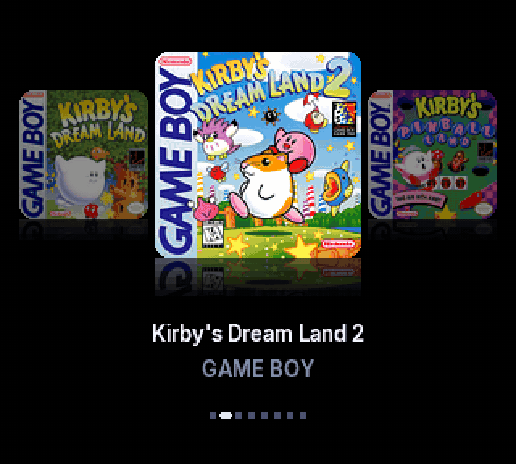</td>
  </tr>
  <tr>
    <td align="center"><sub>A cart going in and coming out</sub></td>
    <td align="center"><sub>A cart that isn't in your library</sub></td>
  </tr>
  <tr>
    <td width="50%">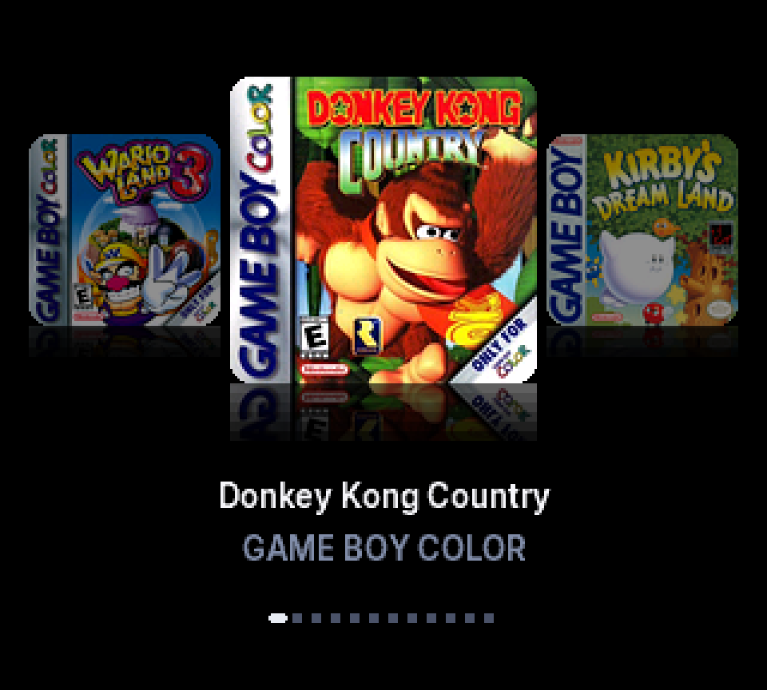</td>
    <td width="50%">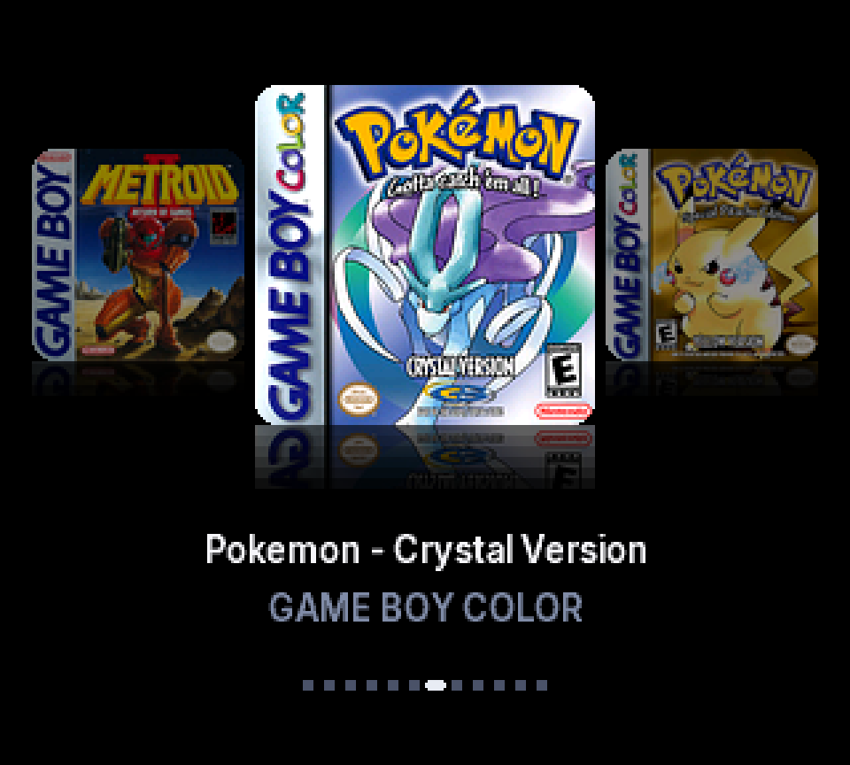</td>
  </tr>
  <tr>
    <td>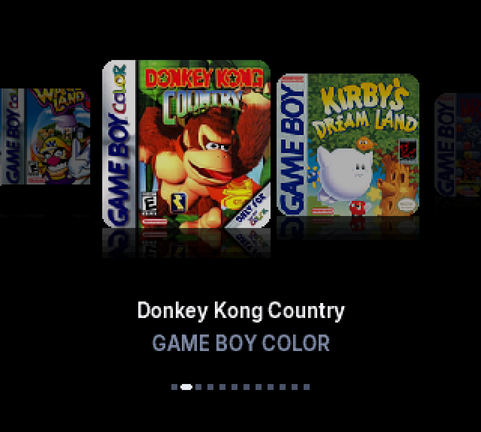</td>
    <td>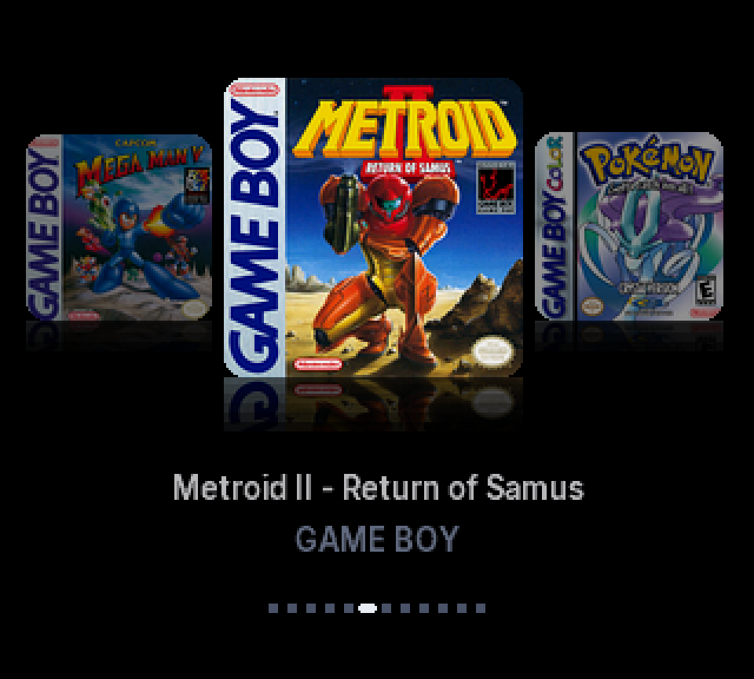</td>
  </tr>
  <tr>
    <td>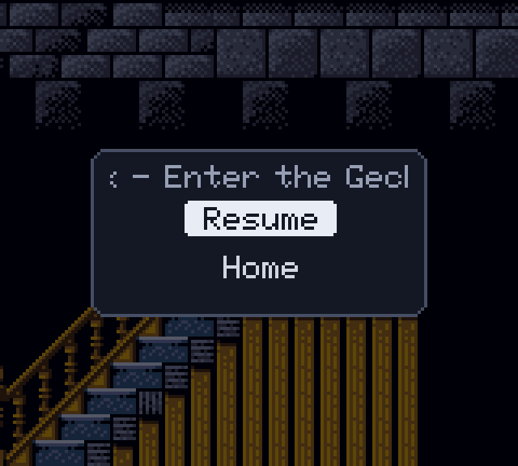</td>
    <td>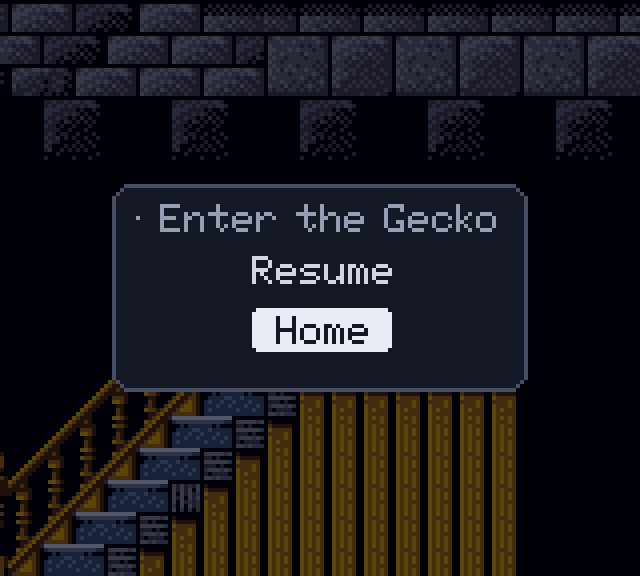</td>
  </tr>
</table>

## What it does

| | |
|---|---|
| Browse | Left and Right glide the covers over 8 frames with an ease-out. Hold to scroll. Long titles scroll as a marquee. |
| Favorites | The menu opens on your favorites, and only your favorites. After the last one comes an All games cover; A on it opens the full list. |
| All games | Every game once, A to Z. Up and Down jump to the previous and next letter, which shows under the title. |
| Select | Steps through Favorites, All games, and the inserted Cartridge (when there is one). Each keeps your place. The mode shows under the title. |
| Cartridge | The core reads the cart's header at boot and about once a second while the menu is open. If it matches a game in your pack (the exact revision, or failing that the same internal title), that cover drops in from the top as the list slides away below, seats with a small bounce, a ring of light, a shine and a click, and keeps a soft glow in the cover's own colors. A boots the real cart with the save on its own battery. Left, Right or Select lift it away and bring your list back where you left it. Pull the cart and the same happens, with CARTRIDGE REMOVED. |
| Unknown carts | A cart that isn't in your library still drops in, as a drawing of its cartridge (gray, black or clear, like the real shells) with the title from its header, and A plays it. The core notes its header in `/Saves/gbc/common/carts.cfg`; on the next sync the companion app identifies the game and adds its box art, so the next time it shows its real cover. |
| Options | X opens the selected game's options: Play, Start over (drops a suspend point and boots fresh), favorite on or off, Back. Favorites changed on the Pocket go to `favorites.cfg` and the companion app applies them on the next sync. |
| Launch | A opens the ROM, streams it into cartridge memory, loads its `.sav` and boots it. |
| Pause | L in game freezes the Game Boy, dims the picture and shows Resume and Home with a short chime. B or L again resumes. |
| Home | Writes the battery save, writes a save state to a `.sus` file next to it, and goes back to the covers. |
| Resume | Launching a game with a `.sus` file restores that save state, then empties the file so it is used once. |
| Saves | Uses the same `/Saves/gbc/common/<game>.sav` files as the original core, so existing saves carry over. |

R is still fast forward. In game, Select and X are left alone because games use them.

## The companion app

<table>
  <tr>
    <td width="50%">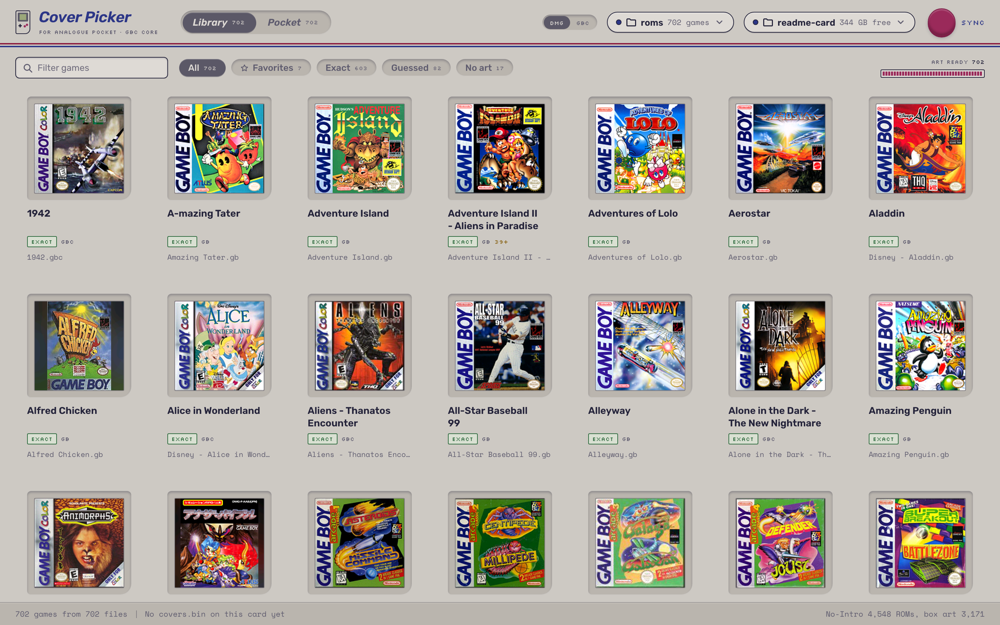</td>
    <td width="50%">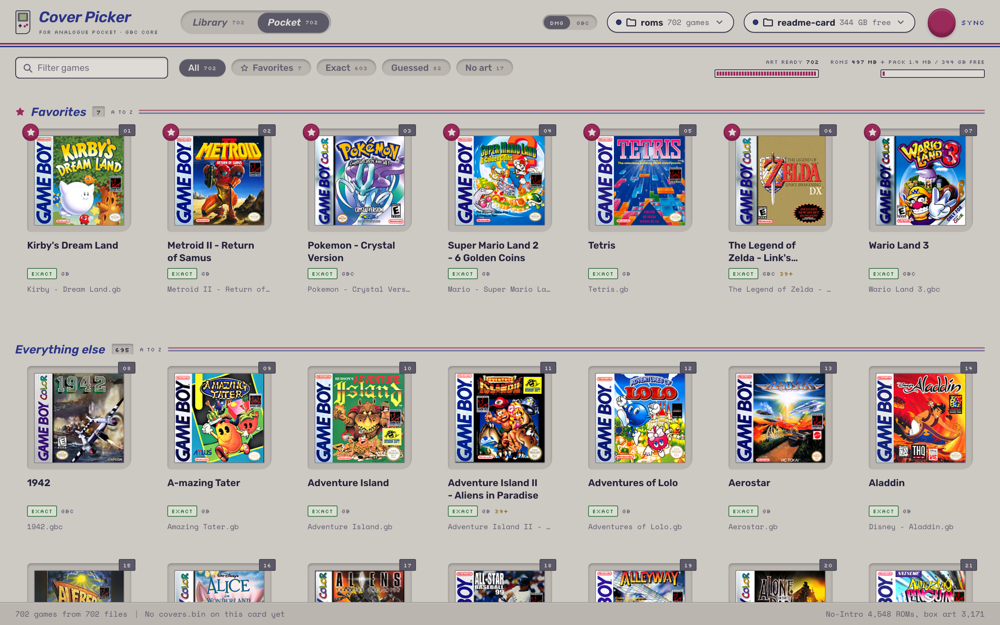</td>
  </tr>
  <tr>
    <td>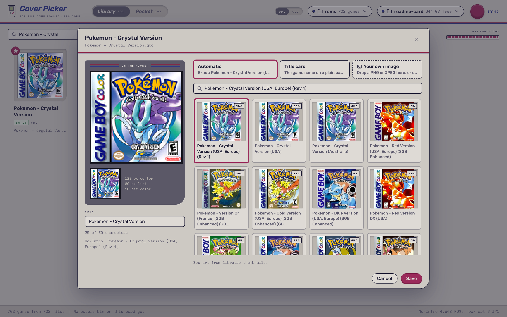</td>
    <td>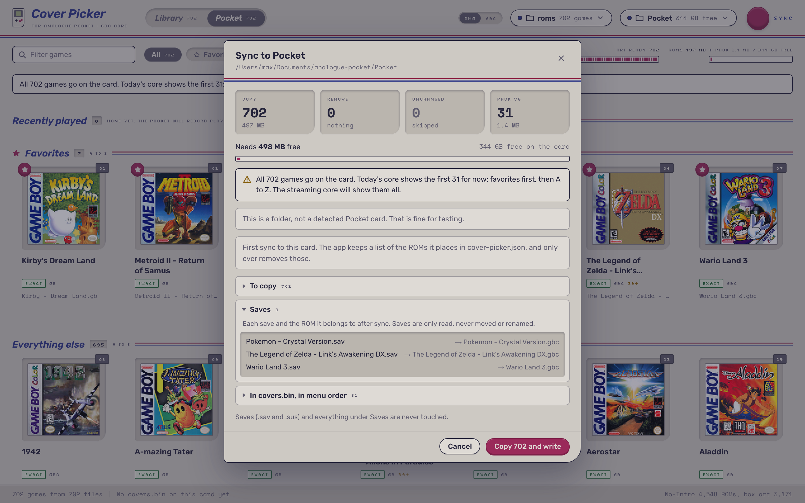</td>
  </tr>
  <tr>
    <td>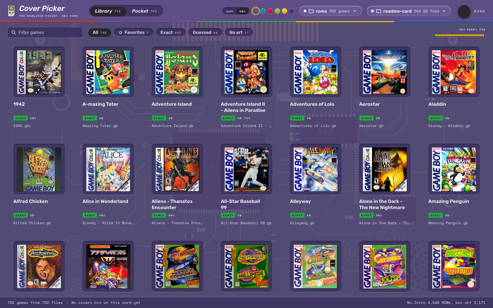</td>
    <td>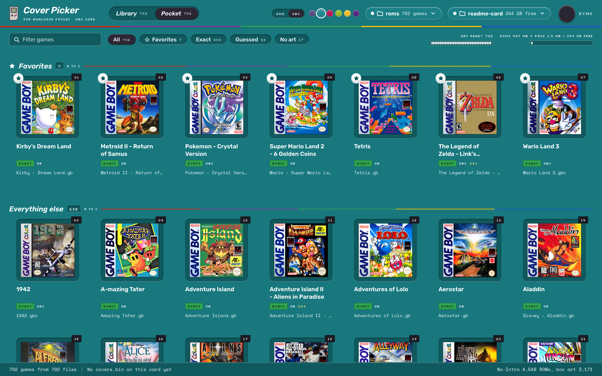</td>
  </tr>
</table>

A local web app: a Node backend that reads your ROM folder and the SD card, and a React page in your browser. It lives in [`companion/`](companion/).

| | |
|---|---|
| Library | Point it at one folder. Every ROM is named by CRC32 against the No-Intro database, and duplicates merge. |
| Box art | Found in libretro-thumbnails automatically. Click a cover to pick another, search, or drop in your own image. |
| Favorites | Star games in the app. The Pocket opens on them, and they stay under their letter in the full A to Z list. The pack carries a letter index, so Up and Down jump straight to a letter. A new dump of a game at the same path keeps its star, cover and title. |
| Sync | A plan shows what will be copied, removed and kept, and checks free space first, then shows live progress. ROMs are copied, checked by CRC, then renamed into place. The app only removes ROMs it placed, and it never touches battery saves. |
| Your card | ROMs already on the card are adopted under their current names, so their saves keep working. A card ROM with the same name as a library game but different contents is kept, because its save is tied to that name. If a ROM's contents change, its suspend point (a save state of the old ROM) is backed up and cleared; battery saves are never touched. |
| Cartridges | The pack carries a fingerprint of every game (header checksums and internal title), so the core can recognize an inserted cart, even a different revision of a game you own. Carts the Pocket didn't know show up under Cartridges after a sync, named by their game code or title, with box art you can change. They go into the pack as cartridge-only entries: they don't appear in your list, only when that cart is inserted. |
| Favorites from the Pocket | Stars changed on the Pocket (X, then favorite) are saved on the card and applied on the next sync. |
| Themes | DMG, and Game Boy Color with six shells. Atomic Purple shows the board through the plastic. |

The app reads the core version on the card. With the streaming core it writes every game (up to 2047) to the pack; with an older core it writes the first 31 of the sync order.

```sh
cd companion
npm install
npm start          # opens http://localhost:4390
```

## Using it

1. Copy the `Cores/maxsorto.GBC` folder from a build to the card, next to the original core.
2. Open the companion app, pick your ROM folder and the card, and sync. It writes the ROMs and `/Assets/gbc/common/covers.bin`. (`tools/make_cover_pack.py` makes the pack from the command line too.)
3. Open the core. The menu appears after about a second. It can be turned off in Core Settings, Cover Menu.

Controls in the menu: Left and Right to browse, Up and Down to jump by letter, Select for favorites, all games or the cartridge, X for a game's options, A to play. In game: L to pause, Up and Down to choose, A to confirm.

## How it works

<p align="center">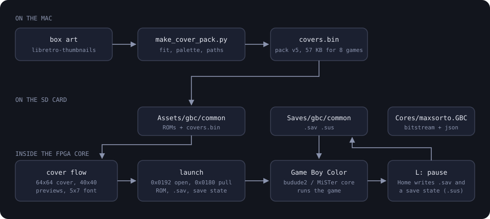</p>

- **The pack.** The companion app (or `tools/make_cover_pack.py`) fits each cover on a blurred copy of itself and stores it in 16-bit color: a 128x128 center and an 80x80 preview. Titles, ROM sizes, and the ROM, save and suspend paths go in the same file.
- **Streaming covers.** The Pocket's SDRAM holds 128 covers above the cartridge ROM area, as a cache: game g lives in slot g mod 128. A background loader reads the covers nearest the selection from the card with APF target command 0x0180 (the selected game first, then its neighbors, then four ahead in the scroll direction), about 29 ms each. A cover may only evict a slot whose game is further from the selection, so nearby games never take turns evicting each other. Each game's title and flags are read from the card when it is selected. A library can have up to 2047 games.
- **Sharing SDRAM.** Cover words wait in a 256-entry FIFO and are written in the SDRAM cycles the line fetcher leaves free, so the menu keeps drawing while covers load. A cover that has not arrived yet draws as a dark tile.
- **Cartridges.** Cart power is on while the core runs (core.json `cartridge_adapter` 0x41000000). At boot, with the Game Boy held in reset, the core reads header bytes 0x134 to 0x14F over the cart bus, checks the header checksum, then scans the pack's fingerprint table: first for the same global and header checksums, then for the same 11-byte title CRC. When a game cart is in and the core isn't playing it, every cart pin is held at bus idle (address 0, /RD, /WR and /CS high), so a powered cart never sees stray writes. Launching the cart switches the Game Boy to physical cartridge mode.
- **Unknown carts.** The pack ends with three default cartridge images. Exact black (RGB565 0x0000) in them is transparent, so the cart's silhouette sits on the glow. A cart that matches nothing gets the image for its header's Color flag and its title from header bytes 0x134 onward. Its header is appended to `carts.cfg` (data slot 105): the record first, then the count, so a half-written file is never misread.
- **Transitions.** The cartridge sits above the list. Going in, both rows move together 256 lines apart, so no screen line ever has two covers in one column, and the line fetcher simply fetches each cover at its new height. The covers that leave come from a snapshot taken as the transition starts; the ones that arrive are the live selection, and the move waits until the arriving cover is in the cache. The glow and the ring are computed per pixel from the squared distance to the cover (no square root), dithered with a 4x4 Bayer matrix. The curves are generated by `tools/anim_model.py`, which also renders a preview of the whole sequence with the same integer math.
- **Video.** The menu has its own 320x288 timing on its own scaler mode. A line fetcher reads each cover from SDRAM two lines ahead, scaled on the fly, so covers can grow, shrink and slide every frame. The title uses Inter at 13 px with antialiasing. The game switches back to the Game Boy's 160x144 when it launches.
- **Opening files.** Paths are copied from the pack straight into the 0x0192 parameter struct. The struct answers bridge reads one transaction late, which is how every APF bridge device behaves. Getting that wrong returns "malformed path".
- **Saves.** The core reports the save size in its data table. The menu opens the matching `.sav` into the Save slot, reads it into cartridge RAM, and creates it at that size if it does not exist yet.
- **Suspend.** Home triggers the core's own save state machinery, the same one the Pocket's save states use, and streams it into the game's `.sus` file with 0x0184. Resume streams it back and signals a load.
- **Testing.** Verilator testbenches (`tools/sim/run.sh`, about a minute per scenario) play the Pocket's side: a fake card that serves opens, reads and writes, and a model of the SDRAM. `tools/sim/tb_suspend.sv` runs launch, pause, Home and resume end to end. `tools/sim/tb_stream.sv` holds Right through a library bigger than a deliberately tiny 8-slot cache and checks every visible cover word for word against the pack. `tools/sim/tb_vt.sv` runs the cartridge transitions: a known cart seating at boot, and an unknown cart pushing the list out, being logged to `carts.cfg`, and pulled again. The menu screenshots here are frames from these simulations.

## Debugging on hardware

The menu runs on the Pocket's FPGA, so a hardware bug can't be stepped through. Two aids are built in.

**Debug log.** The core records events in a 511-entry buffer: state machine steps with their data slot errors, changes in the SDRAM and reset signals, samples of the cover pixels it fetched, the Pocket's cartridge message, and the inserted cart's header and title CRC. The first 64 entries (the boot) are kept; the rest is a ring of the latest events. The per-character text layout steps are not recorded. About 3 seconds after the menu settles, after boot and after every Home, it writes the buffer to `/Saves/gbc/common/picker.log` on the SD card. The file is data slot 103. Put the card in a computer and run:

```sh
python3 tools/read_picker_log.py /Volumes/Pocket/Saves/gbc/common/picker.log
```

It prints one line per event with a timestamp in milliseconds and the state names taken from `cover_picker.sv`. The cover pack holds the log's path after the game paths, so packs made with an older `make_cover_pack.py` have no log.

**Status squares.** Set `DEBUG_SQUARES` to 1 at the top of `cover_picker.sv` and rebuild, and a row of small squares along the top of the menu shows the same signals live. Green means the signal was seen in the last 30 ms and dark red means it wasn't. They're in groups of four, left to right, in the order of the `DBG` list in `tools/read_picker_log.py`. A phone video of the screen is enough to read them.

To add a signal, wire it into `dbg` in `core_top.sv` (or the picker's own bits), then add its name to `DBG`. To log a new event, add a branch to the logger at the end of `cover_picker.sv`.

## Build it

Quartus Prime Lite 22.1 runs in an x86 container. On Apple Silicon that means Colima with Rosetta.

```sh
colima start -p quartus --vm-type vz --vz-rosetta --cpu 8 --memory 16
cd src
docker run --rm --platform linux/amd64 -v "$PWD/..":/build -w /build/src \
  didiermalenfant/quartus:22.1-apple-silicon \
  /opt/intelFPGA/quartus/bin/quartus_sh --flow compile ap_core.qpf

python3 -m venv .venv && .venv/bin/pip install pillow
.venv/bin/python tools/fetch_boxart.py /Volumes/Pocket/Assets/gbc/common covers
.venv/bin/python tools/make_cover_pack.py --roms /Volumes/Pocket/Assets/gbc/common --covers covers --out covers.bin
sh tools/package_core.sh covers.bin stage
cp -R stage/. /Volumes/Pocket/
```

A full compile takes about ten minutes. `ap_core.qsf` limits Quartus to one worker because parallel fitting deadlocks under emulation.

## What's done and what's next

Done:
- Cover flow menu at 320x288 with full-color covers, reflections, eased animation, marquee titles and a position bar
- Streaming covers for libraries up to 2047 games (700+ verified on hardware)
- Letter jumps, a favorites mode, and a per-game options menu with Start over and favorites saved on the Pocket
- Launching from the menu, battery saves in the usual place, pause, Home and suspend to the exact frame
- Cartridges: the inserted cart drops in on its own cover with a seating animation and plays with its own save; unknown carts show as a cartridge and get their box art on the next sync
- An on-card debug log and diagnostic squares for hardware bugs
- The companion app: library by checksum, automatic box art, favorites, a sync plan that protects saves, two themes

Next:
- Favorites that update on the Pocket: starring or unstarring a game changes Favorites mode right away, before the next sync
- Home while playing a real cartridge
- A grid view, then play history (recently played first) and a settings screen
- Copy a cartridge's save to the SD card from the cart's options, so the ROM version continues it
- A web version of the companion app for Windows and Linux, and a release for the openFPGA cores inventory

## Repository layout

- `src/core/cover_picker.sv`: the menu, cover cache, cartridge transitions, launch, pause, save and suspend logic, cartridge lookup and logging, debug log and the menu sounds
- `src/core/core_top.sv`: wiring into the GBC core (bridge, data slots, save states, SDRAM sharing, the cart header reader and pin idling, video and audio mix)
- `src/core/picker_dpram.v`: block RAM wrapper used by the menu
- `pkg/gbc/Cores/budude2.GBC/data.json`: data slots, including Cover Pack (100), Game (101), Suspend (102), Debug Log (103), Favorites (104) and Carts (105)
- `companion/`: the Mac companion app (Hono backend in `server/`, React UI in `web/`)
- `tools/`: pack builder, box art fetcher, default cartridge art (`make_cart_art.py`), transition model and preview (`anim_model.py`), bitstream reverser, packaging script, debug log reader
- `tools/sim/`: Verilator testbenches with a fake Pocket host (`run.sh` builds and runs one)
- `docs/images/`: README images

## Credits, license and legal

- The emulation is the MiSTer Gameboy core by its contributors, ported to the Pocket by budude2. The openFPGA framework files are Analogue's. Their code keeps its original terms.
- The cover picker module, the testbenches and the tools in `tools/` are MIT.
- The 5x7 font is the Adafruit GFX glcdfont (BSD).
- Box art in the screenshots comes from the libretro-thumbnails community scans. Covers are not in the repo. `fetch_boxart.py` downloads them on your machine. The in-game frame under the pause panel is a libretro-thumbnails snap.
- Game Boy, Game Boy Color and Analogue Pocket are trademarks of their owners. This project is not affiliated with Nintendo or Analogue.
- Bring your own ROMs and BIOS. If you own something shown here and want it removed, open an issue and it will come down.

The original core's README follows.

---

# Gameboy/Game Boy Color for Analogue Pocket
Ported from the original core developed at https://github.com/MiSTer-devel/Gameboy_MiSTer

Please report any issues encountered to this repo. Issues will be upstreamed as necessary.

## Installation
To install the core, copy the `Assets`, `Cores`, and `Platform` folders over to the root of your SD card. Please note that Finder on macOS automatically _replaces_ folders, rather than merging them like Windows does, so you have to manually merge the folders.

Place the GBC bios in `/Assets/gbc/common` named "gbc_bios.bin", the GB bios in `/Assets/gb/common` named "gb_bios.bin", and the SGB bios in `/Assets/gb/common` named "sgb_boot.bin".

## Usage
ROMs should be placed in `/Assets/gbc/common`, and `/Assets/gb/common`

## Features

### Supported
* Real-Time Clock
* Fastforward
* Original Gameboy display modes
* Super Gameboy Emulation
* Custom Borders (SGB)
* Custom Palettes (SGB)
* Enhance GBA features
* Save States and Sleep
* External Cartridges

### In Progress
¯\\_(ツ)_/¯
