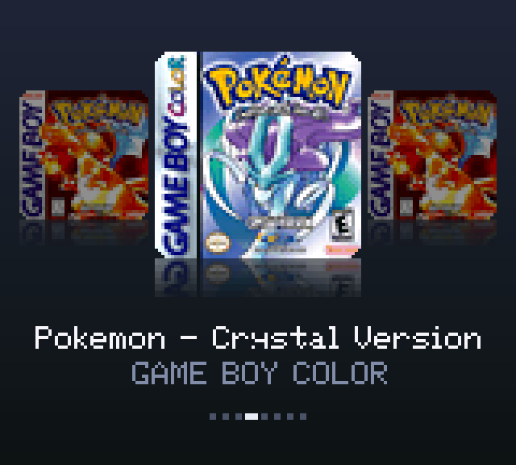
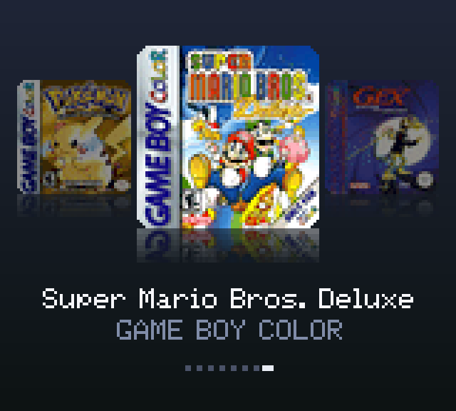
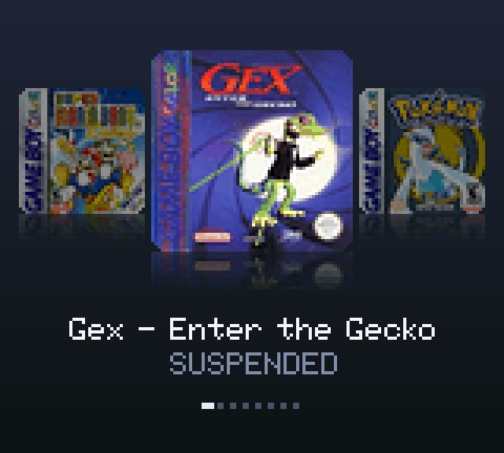
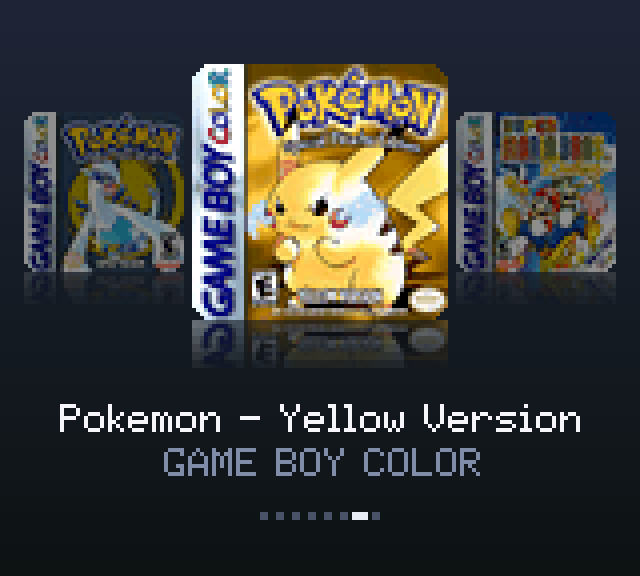

<p align="center"></p>

# Cover Flow for the Analogue Pocket

A box-art game menu that lives inside the Game Boy Color core on the Analogue Pocket. Turn the core on and you land on your library as covers: the selected game in the middle, its neighbors dimmed on each side, reflections on the floor and the title underneath. Press A and the game boots with its battery save loaded. Press L in game to pause, then Resume, or go Home to the covers with the game suspended. Pick it again later and it comes back on the exact frame you left.

<p align="center"><b>Get it: <a href="https://github.com/maxsorto/openfpga-GBC/tree/cover-picker">the cover-picker branch</a></b><br>Analogue Pocket, openFPGA. Game Boy and Game Boy Color games.</p>

This is a fork of budude2's openFPGA GBC core, which is a port of the MiSTer Gameboy core. The emulation is theirs. The menu, saves and suspend are new. No ROMs, BIOS files or box art are in this repo.

<table>
  <tr>
    <td width="50%"></td>
    <td width="50%"></td>
  </tr>
  <tr>
    <td></td>
    <td></td>
  </tr>
  <tr>
    <td></td>
    <td></td>
  </tr>
</table>

## What it does

| | |
|---|---|
| Browse | Left and Right move through the library. Hold to scroll. Long titles scroll as a marquee. |
| Launch | A opens the ROM, streams it into cartridge memory, loads its `.sav` and boots it. |
| Pause | L in game freezes the Game Boy, dims the picture and shows Resume and Home with a short chime. B or L again resumes. |
| Home | Writes the battery save, writes a save state to a `.sus` file next to it, and goes back to the covers. |
| Resume | Launching a game with a `.sus` file restores that save state, then empties the file so it is used once. |
| Saves | Uses the same `/Saves/gbc/common/<game>.sav` files as the original core, so existing saves carry over. |

R is still fast forward. Select is left alone because games use it.

## Using it

1. Copy the `Cores/maxsorto.GBC` folder from a build to the card, next to the original core.
2. Make a cover pack on a computer and copy it to `/Assets/gbc/common/covers.bin`.
3. Open the core. The menu appears after about a second. It can be turned off in Core Settings, Cover Menu.

Controls in the menu: Left and Right to browse, A to play. In game: L to pause, Up and Down to choose, A to confirm.

## How it works

<p align="center"></p>

- **The pack.** `tools/make_cover_pack.py` fits each cover on a blurred copy of itself, quantizes it to 256 colors (64x64 for the center, 40x40 for the previews), and writes titles, ROM sizes and the ROM, save and suspend paths into one file.
- **Pulling data.** The core reads the pack itself with APF target command 0x0180, a few kilobytes per selection, because the FPGA has only 13 spare block RAMs.
- **Opening files.** Paths are copied from the pack straight into the 0x0192 parameter struct. The struct answers bridge reads one transaction late, which is how every APF bridge device behaves. Getting that wrong returns "malformed path".
- **Saves.** The core reports the save size in its data table. The menu opens the matching `.sav` into the Save slot, reads it into cartridge RAM, and creates it at that size if it does not exist yet.
- **Suspend.** Home triggers the core's own save state machinery, the same one the Pocket's save states use, and streams it into the game's `.sus` file with 0x0184. Resume streams it back and signals a load.
- **Video.** The menu draws into the Game Boy's 160x144 frame at 6.7 MHz in three pipeline stages. The pause panel is drawn over the frozen game frame, which is dimmed to about 3/8 brightness.
- **Testing.** Icarus Verilog testbenches play the Pocket's side: a fake card that serves opens, reads and writes. `tools/sim/tb_suspend.sv` runs launch, pause, Home and resume end to end. The screenshots here are frames from that simulation.

## Debugging on hardware

The menu runs on the Pocket's FPGA, so a hardware bug can't be stepped through. Two aids are built in.

**Debug log.** The core keeps the last 511 events in a ring buffer: state machine steps with their data slot errors, changes in the SDRAM and reset signals, and samples of the cover pixels it fetched. About 3 seconds after the menu settles, after boot and after every Home, it writes the buffer to `/Saves/gbc/common/picker.log` on the SD card. The file is data slot 103. Put the card in a computer and run:

```sh
python3 tools/read_picker_log.py /Volumes/Pocket/Saves/gbc/common/picker.log
```

It prints one line per event with a timestamp in milliseconds and the state names taken from `cover_picker.sv`. The cover pack holds the log's path after the game paths, so packs made with an older `make_cover_pack.py` have no log.

**Status squares.** Set `DEBUG_SQUARES` to 1 at the top of `cover_picker.sv` and rebuild, and a row of small squares along the top of the menu shows the same signals live. Green means the signal was seen in the last 30 ms and dark red means it wasn't. They're in groups of four, left to right, in the order of the `DBG` list in `tools/read_picker_log.py`. A phone video of the screen is enough to read them.

To add a signal, wire it into `dbg` in `core_top.sv` (or the picker's own bits), then add its name to `DBG`. To log a new event, add a branch to the logger at the end of `cover_picker.sv`.

## Build it

Quartus Prime Lite 22.1 runs in an x86 container. On Apple Silicon that means Colima with Rosetta.

```sh
colima start -p quartus --vm-type vz --vz-rosetta --cpu 8 --memory 16
cd src
docker run --rm --platform linux/amd64 -v "$PWD/..":/build -w /build/src \
  didiermalenfant/quartus:22.1-apple-silicon \
  /opt/intelFPGA/quartus/bin/quartus_sh --flow compile ap_core.qpf

python3 -m venv .venv && .venv/bin/pip install pillow
.venv/bin/python tools/fetch_boxart.py /Volumes/Pocket/Assets/gbc/common covers
.venv/bin/python tools/make_cover_pack.py --roms /Volumes/Pocket/Assets/gbc/common --covers covers --out covers.bin
sh tools/package_core.sh covers.bin stage
cp -R stage/. /Volumes/Pocket/
```

A full compile takes about ten minutes. `ap_core.qsf` limits Quartus to one worker because parallel fitting deadlocks under emulation.

## What's done and what's next

Done:
- Cover flow menu with previews, reflections, marquee titles and page dots
- Launching from the menu, battery saves in the usual place
- Pause panel on L with Resume and Home, and a chime
- Suspend to a save state and resume on the exact frame

Next:
- A sharper menu at 320x288, scaled 5x to the Pocket's screen
- Full-color covers kept in the unused PSRAM chips, for instant scrolling
- Show which games have a resume point before they are first selected

## How long it took

Built in one Claude Code session with Claude Opus 5.5, measured from the transcript.

| | |
|---|---|
| Start | 2026-10-25 17:21 EDT |
| Latest build | 2026-10-25 23:51 EDT |
| Wall clock | 6 h 30 min |
| Messages from Max | 56 |
| Assistant turns | 808 |
| Output tokens | 980,000 |
| Cache reads | 474 million tokens |
| Hardware builds | 11 |

## Repository layout

- `src/core/cover_picker.sv`: the menu, launch, pause, save and suspend logic, and the pause chime
- `src/core/core_top.sv`: wiring into the GBC core (bridge, data slots, save states, video and audio mix)
- `src/core/picker_dpram.v`: block RAM wrapper used by the menu
- `pkg/gbc/Cores/budude2.GBC/data.json`: data slots, including Cover Pack (100), Game (101) and Suspend (102)
- `tools/`: pack builder, box art fetcher, bitstream reverser, packaging script, debug log reader
- `tools/sim/`: Icarus testbenches with a fake Pocket host
- `docs/images/`: README images

## Credits, license and legal

- The emulation is the MiSTer Gameboy core by its contributors, ported to the Pocket by budude2. The openFPGA framework files are Analogue's. Their code keeps its original terms.
- The cover picker module, the testbenches and the tools in `tools/` are MIT.
- The 5x7 font is the Adafruit GFX glcdfont (BSD).
- Box art in the screenshots comes from the libretro-thumbnails community scans. Covers are not in the repo. `fetch_boxart.py` downloads them on your machine. The in-game frame under the pause panel is a libretro-thumbnails snap.
- Game Boy, Game Boy Color and Analogue Pocket are trademarks of their owners. This project is not affiliated with Nintendo or Analogue.
- Bring your own ROMs and BIOS. If you own something shown here and want it removed, open an issue and it will come down.

The original core's README follows.

---

# Gameboy/Game Boy Color for Analogue Pocket
Ported from the original core developed at https://github.com/MiSTer-devel/Gameboy_MiSTer

Please report any issues encountered to this repo. Issues will be upstreamed as necessary.

## Installation
To install the core, copy the `Assets`, `Cores`, and `Platform` folders over to the root of your SD card. Please note that Finder on macOS automatically _replaces_ folders, rather than merging them like Windows does, so you have to manually merge the folders.

Place the GBC bios in `/Assets/gbc/common` named "gbc_bios.bin", the GB bios in `/Assets/gb/common` named "gb_bios.bin", and the SGB bios in `/Assets/gb/common` named "sgb_boot.bin".

## Usage
ROMs should be placed in `/Assets/gbc/common`, and `/Assets/gb/common`

## Features

### Supported
* Real-Time Clock
* Fastforward
* Original Gameboy display modes
* Super Gameboy Emulation
* Custom Borders (SGB)
* Custom Palettes (SGB)
* Enhance GBA features
* Save States and Sleep
* External Cartridges

### In Progress
¯\\_(ツ)_/¯
